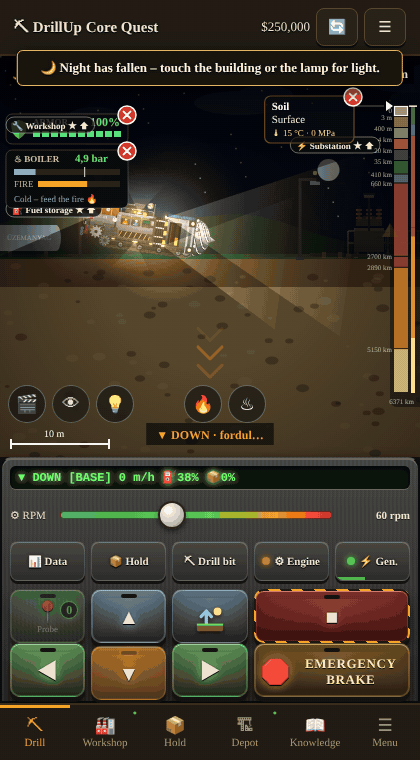
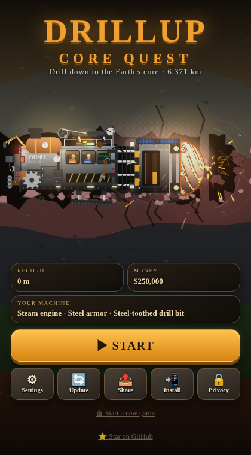
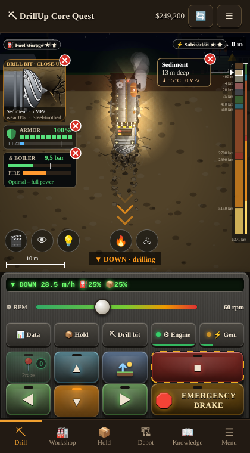

# DrillUp Core Quest

[🇬🇧 English](README.md) · 🇭🇺 Magyar

<p align="center"></p>

<p align="center"><b><a href="https://drillup-seven.vercel.app">▶ Játék most</a></b> &nbsp;·&nbsp; <b><a href="https://github.com/strattila90-hue/DrillUp/releases/latest/download/CoreQuest.apk">📱 APK letöltése</a></b></p>

<p align="center">

[](LICENSE)
[](https://github.com/strattila90-hue/DrillUp/commits)
[](https://github.com/strattila90-hue/DrillUp/releases/latest)
[](https://github.com/strattila90-hue/DrillUp)


[](https://github.com/strattila90-hue/DrillUp/stargazers)

</p>

Fúrj le a Föld magjáig – 6 371 km – valós méterekben. Lánctalpas fúrógép, valódi földtani rétegek, hőmérséklet és nyomás, kopás és páncél, depó tehervonattal, ásványok, kövületek és gyűjthető filmes relikviák. Egyjátékos, offline is működik, nincs hirdetés, regisztráció vagy követés.

## Képernyőképek
<p> &nbsp; </p>

## Jellemzők
- **Valós léptékek**: talaj → kéreg → köpeny → külső mag → belső mag, a rétegek valósághű vastagságával (jobb oldali rétegtérkép).
- **Fejleszthető gép**: motorok (gőz → dízel → gázturbina → atom), páncél, 6 fúrófej-szint, generátor, kazán, zuhanófék mechanikus karokkal, hidraulikus felállító toronydaruval.
- **Depó és gazdaság**: kirakodás, tömörítés, tárolás, eladás tehervonattal. A raktártelep, a szalag, a vagonok és a mozdony **20. szintig** fejleszthető (legfeljebb a 20. szintig). Teherkikötő portáldarukkal, vasúti jelzők.
- **Felfedezés**: szeizmográf és szondák, olaj- és gázmezők, vulkánok, mobil geológiai labor, valós fúrás-történeti beszámolók, rejtett leletek.
- **Dicsőségfal**: 12 eredeti, kitalált filmes relikvia.
- **Nyelvek**: magyar és angol (Menü → Beállítások → Language; első indításkor angol az alapértelmezés).
- **PWA**: telepíthető, offline működik, a mentés az eszközödön marad.

## Futtatás / fejlesztés
Nincs build-lépés – statikus fájlok.
```
python3 -m http.server 8000      # majd http://localhost:8000
npm test                         # node tests/run.js  (böngésző nélkül)
node tests/par.js 2              # teljes tesztfutás 2 folyamaton (~3 perc)
```
Felépítés: `index.html` (mag + inline szkript) · `js/*.js` (funkciómodulok, sima script-tagek) · `ui.css` · `sw.js` (service worker, hálózat-első; új fájlnál bővítsd az `A` listát és emeld a `V` gyorsítótár-nevet) · `manifest.webmanifest` · `tests/`.

### Lokalizáció
A `js/i18n.js` fordítási réteg: angol nyelvnél a megjelenő szöveget (DOM-szöveg, címkék, vászonra rajzolt feliratok) a `js/i18n_en.js` szótára alapján cseréli (`"magyar szöveg": "English text"`). Ami nincs a szótárban, magyarul marad. Új szöveg: vedd fel a szótárba. A nyelv a `localStorage`-ban van (`du_lang`), nem a mentésben.

## Mentés
A böngésző helyi tárolójában. Menü → Beállítások → Adatok: rendszeresen **exportáld / importáld** a mentést.

## Kompatibilitás
Chrome / Android WebView 80+, Safari 13.1+. A `js/compat.js` pótolja az `Array.at`, `flat`, `flatMap` függvényeket régebbi motorokon. Érintés-központú, álló tájolás; rezgés, képernyő-ébrentartás és teljes képernyő csak ahol elérhető.

## Önálló APK / iOS
Teljesen offline, önálló Android APK és iOS-csomag (Capacitor) – a GitHub Actions készíti, lásd [`mobile/README.md`](mobile/README.md).

## Google Play
A Play-változat a hosztolt PWA köré épített Trusted Web Activity – lásd [`play/CHECKLIST.md`](play/CHECKLIST.md), [`play/STORE_LISTING.md`](play/STORE_LISTING.md), [`privacy.html`](privacy.html).

## Technológia
Sima JavaScript, HTML5 canvas és CSS – nincs keretrendszer, nincs csomagoló, nincs futásidejű függőség. Telepíthető PWA service workerrel; az Android/iOS változat ugyanezeket a fájlokat csomagolja Capacitorral. A tesztek sima Node-szkriptek (`tests/`).

## Közreműködés
Hibajelentést, ötletet és pull requestet szívesen fogadunk – lásd [CONTRIBUTING.md](CONTRIBUTING.md). A `good first issue` címkéjű feladatok jó kezdőpontok.

## Licenc / közreműködők
[MIT licenc](LICENSE) alatt. A játék minden tartalma és a filmes relikviák eredetiek, kitaláltak. Fejlesztő: strattila90.

## v5.40
- A mélységsáv réteghatár-feliratai (4 km, 20 km, 410 km …) nem íródnak a jobb oldali műszeroszlop alá – csak ott jelennek meg, ahol nem takarja őket műszer.

## v5.39
- Elrendezés-finomítás: kis telefonon a jobb oldali műszeroszlop nem csúszik a kamera / panel / gőz gombok alá (a legalsó műszerek inkább elrejtőznek), a fúrófej közeli nézetének címét nem vágja le a bezáró gomb, és a mélyben túl erős munkalámpa-fény a gép körül visszafogottabb, így a test részletei látszanak.

## v5.38
- Villogás- és remegés-javítás, rögzített 60 fps-es képkocka-összehasonlítással mérve: a fúrófej közeli nézete nem stroboszkópol (a forgásszög összegződik, nem idő × ingadozó sebesség), a gép fúrás közbeni rezgése kisebb és lassabb (nincs 18–22 Hz-es élremegés), a fej melletti porfelhők nem ugrálnak, és a minőség-szabályozó ismételt visszaesés után egyre később lép vissza felfelé (kevesebb felbontásváltási villanás gyenge telefonon).

## v5.37
- **Pajzsos (TBM) felépítés:** elöl a legnagyobb átmérőjű vágófej, mögötte a pajzs, a tolóhengerek és a fejnél kisebb hengeres hajótest. A tetőről lekerült a kazán, a tartály, a daru és a kémény, így a gép belefér a saját furatába. A hajótestben van a kabin, a motortér, a támasztótalpak és a törmelékszállító csiga, amely a farok garatából üríti ki a kőzetet; a lánctalp a föld alatt behúzódik.
- **A felszínen minden kinyílik:** a motortér ajtói felnyílnak, a motor ollós emelőn kiemelkedik és „lélegzik”, kitolódik a műszerárboc (forgó radar, élő műszer, szélmérő, jelzőfény), a pajzslemezek felemelkednek, alattuk forog a hajtómű.
- **Fúrás közben** a pajzs oldalsó fékező hidraulikája ütemesen a falnak feszül.
- **Kezelőpult:** háttér nélkül a játékkép fölött lebeg, a szöveges info-sáv megszűnt; új műszer: a porszemcse-generátor töltöttsége (kéken villog, ha dolgozik).

## v5.36
- **Statikus porszemcse-generátor**: ha minden üzemanyag elfogyott (tank, raktár, pénz), a gép tetején lévő eszköz a levegő porából nagyon kevés üzemanyagot gyűjt (a tank 1,5%-áig). A gép így nem vész el a mélyben, és a bázison pénz nélkül sem ragad be: feltöltés után magától továbbindul.
- Tankolás: negatív egyenlegnél a „Tele” gomb már nem veszi el az üzemanyagot; a Műhelyben a kedvezményes ár látszik; visszajelzés tankoláskor, tele tanknál és pénzhiánynál; a tartalék-határ üzenete a teljes tartalékot mutatja.
- Kis kijelzők (320–400 px): nem vágódnak le a Felszín / Szonda / Zuhanófék feliratok, nem lóg ki a generátor-műszer és a fordulat-csúszka, a jobb oldali műszeroszlop nem csúszik a vezérlőpult alá.
- Élesebb kép nagy felbontású telefonokon (felbontás-sapka 1,4× / 2×).

## v5.35
- **Javítás:** a gép a főmenü alatt tovább haladt (és fogyasztott) – a játék újranyitása után magától akár több tíz métert is megtett. A főmenü megnyitásakor a gép most megáll.

## v5.34
- **Megszűnt a háttér villogása:** az éjszakai csillagok nem ugrálnak függőleges mozgás közben, és a horizont sziluettjei (hegyek, ipar, erdő) nem rajzolódnak újra minden képkockán más magasságban.
- **Élethű kőzetzúzás** (`js/grind.js`): sötét zúzott sáv a fúrófej kúpja mentén, apró, árnyalt forgács, amely a csúcstól oldalra, majd a fal mentén hátrafelé áramlik, az ép kőzetbe növő hajszálrepedések, leváló kőzetlapok, rétegszínű por.
- **Izzó fém és szikrák:** a fúrófej a hő szerint a csúcs felől izzik (sötétvörös → narancs → sárgás fehér), súrlódási izzás a vágóéleken, kemény kőzetben vagy túlhevüléskor ívelt, izzó szikrák pattannak a vágóélekről (a korábbi véletlenszerű csíkok helyett).

## v5.33
- **A gép összes alkatrésze kézzel rajzolva** a referenciakép stílusában (`assets/veh/`): 8 fázisú, animált fúrófej hat vágóéllel, elülső pajzs műszerablakkal, fényszórók, hátsó fogaskerék, motormodulok (dízel kipufogófüsttel, gázturbina forgó szívótorokkal, reaktor pulzáló izzással), illusztrált lánctalp: markolóbordás lánctagok, fogas hajtókerék, vezetőkerék feszítőrugóval, tartógörgők és 6 futógörgő lengőkaron, tekercsrugóval és lengéscsillapítóval. Sérült lánctalpnál a régi rajz marad.

## v5.32
- **Kézzel rajzolt M.E.D.V.E. jármű** a referenciakép alapján (`assets/veh/`): kontúros, festett fényű hajótest szegecssorokkal, ablakkeretek (bennük a legénység), M.E.D.V.E. tábla, sárga-fekete panel, szellőzőrács, hátsó daru lánccal és horoggal, piros lámpák, poroltó, tetőkorlát, műszer; gőzgépnél narancs kazán „M” emblémával és füstölgő kéménnyel. A lánctalp, a fúrófej, a fogaskerék, a füst és a fények animáltak maradtak; a magasabb motorszintek saját modulja megmaradt. A v5.31 fény-árnyék réteg kikerült.

## v5.31
- **Acélos, térhatású jármű:** a gép alakjára maszkolt fény–árnyék réteg (felül csúcsfény, középen acélkék, alul mély árnyék, az alsó élen hideg visszavert fény) – 2D, de 3D hatású; kékes acél alapszín a szürke helyett; lágy talajárnyék a lánctalp alatt.

## v5.30
- **A M.E.D.V.E. jármű a referenciakép stílusában:** vastag sötét kontúr az egész gép körül (cel-shading), hosszabb, nehezebb lánctalp 48 láncszemmel, 6 futógörgővel és 3 tartógörgővel, „M” embléma a narancs tartályon.

## v5.29 – M.E.D.V.E. ipari komplexum (2. szakasz) és új Műhely
- **Műhely újratervezve:** al-fülek (Gépészet · Karbantartás · Fúrófejek); bronzkeretes, szegecselt műszaki rajz meleg borostyán vonalakkal – csak a kiválasztott modul világít, a jelölők rendezetten fent (1–3) és lent (4–6); 3×2 modulrács; fejlesztő kártya szegmentált sávval és Most/Következő összevető táblával.
- **Személyzeti épület:** öltöző, étkező, pihenő, irodák, parkoló. Szakemberek felvétele: Gépész (javítás −20%), Üzemanyag-mester (üzemanyag −10%), Geológus (SG-3 magminták +25%).
- **Energetikai központ:** generátorház kéményekkel (járó generátornál sűrűbb füst), trafóudvar, gőzkifúvás. Kártya: generátor be/ki, trafó-fejlesztés, bázisvilágítás.
- A bázis (tankolás, fejlesztés, felvétel) mostantól az egész ipari telepre kiterjed.

## v5.28 – M.E.D.V.E. ipari komplexum (1. szakasz)
- **Parallax háttér:** havas hegyvonulat, ipari sziluettek füstölgő kéményekkel és légiakadály-fényekkel, erdősáv – a napszakkal együtt változnak.
- **Összefüggő kültér:** betonút sárga jelöléssel, iparvasút talpfákkal, csőhíd, reflektoroszlopok (éjjel valódi fénnyel), konténerudvar rakodórámpával, drótkerítés.
- **Irányítóközpont:** háromszintes épület, irányítóterem élő monitorfallal és kezelőkkel, üvegezett megfigyelőszint, forgó radar, antennaárboc villogóval, ventilátorok. Koppintásra: küldetések (napi és heti kihívások).
- **Alkatrészraktár:** fűrészfogas tető, gördülőkapu, belső tér magas polcrendszerrel, mozgó futódaruval és targoncával. Koppintásra: Raktár.
- A jármű neve a gépen: **M.E.D.V.E.**

## v5.27
- **Laptopon / széles kijelzőn** rendezett felület: a vezérlősáv elemei fix méretűek és középre igazítottak, a főmenü középső oszlopban.
- **Csillogó, kopott fém jármű:** erős tükröződő sáv, mély árnyék, finom karcok és lassan végigfutó csillanás a gép testén és páncélján.

## v5.26
- **L-alakú HUD, kevesebb hely:** a játékkép jóval nagyobb lett. A műszerek doboz nélkül lebegnek a képen (jobb oldalt: nyomás, hőmérséklet, raktár és új fúrófej-kopás óra), alul a vezérlősávban az üzemanyag, a motor és a generátor.
- **Nincs kettős vezérlés:** a Motor/Gen karok és az Adat/Raktár/Fúrófej fülek helyett a műszerekre koppintva kapcsolsz vagy nyitod meg a panelt.
- **Joystick** a négy iránygomb és az ÁLLJ helyett: húzd az irányba; elengedve megáll, végállásba tolva ott marad és a gép megy tovább (arany gyűrű jelzi); koppintás = állj.

## v5.25
- **Új vezérlő-elrendezés:** a ▲▼◀▶ valódi irány-keresztben, középen az ÁLLJ (minden irányból egy mozdulatra); a funkciógombok L alakban veszik körül: jobbra a Felszín és a Szonda, alul a széles Zuhanófék.

## v5.24
- **Orosz típusú mechanikus műszerfal** a kezelőpulton (saját rajz): üvegcsöves üzemanyag-szintjelző, acélperemes nyomásmérő, sárgaréz peremű hőmérő, olívzöld raktár- és generátorműszer, motor-fordulatmérő – csavarozott peremek, piros zónák, rugózó mutatók, járó motornál enyhe remegés, villogó jelzőlámpák. A műszerek érintésre kapcsolnak: motor és generátor be/ki, tankolás, Raktár / Adatok panel.
- A Motor és a Generátor gomb helyett **billenőkar** jelzőlámpával.
- **Indítóállás:** a bázison betonplatform kútfejjel és sárga portáldaruval. Lefelé fúrni csak innen lehet; a daru horga megfogja a gép farkát, a platform közepére húzza és fúrási helyzetbe emeli. A felszínre is csak itt lehet kijönni (a ⌂ hazaút ide vezet).

## v5.23
- **Képek a fúróállomáson:** valódi fotók és szakmai ábrák alapján rajzolt saját illusztrációk (`assets/rig/`): karcsú, piros-fehér árboc és sárga, X-merevítéses alépítmény fehér fúrókabinnal; háromgörgős (keményfém betétes) és PDC-gyémánt fúrófej 6 fázisú forgásanimációval; színkódolt fúrószerelvény (fejcsatlakozó, turbina, stabilizátor, nehézrudak, ütőszerszám, nehéz fúrócső).
- **📘 Fúrószál tananyag:** a fúrószál részei felülről lefelé, a két fúrófej összevetése és a fúrómag magyarázata (az SZTE Földtani és Őslénytani Tanszékének ismeretterjesztő anyaga alapján, saját összefoglalóban).

## v5.22
- **SG-3 fúróállomás – élethű modell:** alépítmény és fúrópadló, kitörésgátló (BOP), csigasor és futócsiga drótkötéllel, a fúrással együtt forgó csörlődob, felső hajtás (top drive) iszaptömlővel, toronypihenő-pódium (kiemeléskor itt sorakoznak a gyertyák), rázószita és gőzölgő iszapmedence, dízel-áramfejlesztő füsttel, triplex iszapszivattyú mozgó dugattyúkkal, reflektorok, sarki hóesés.
- **Föld alatt:** kőzettípusonként saját mintázat, részletes fúrószerelvény (nehézrudak, stabilizátor, forgó turbina, iszapsugarak), a forró mélységben vörösen izzó kőzet.
- **Új játékelemek:** fúrófej-választás (háromgörgős vagy PDC-gyémánt: a PDC puha kőzetben gyorsabb, keményben és forróságban gyorsan kopik), magláda a begyűjtött magmintákkal, mélység–idő görbe.

## v5.21
- **Új főmenü**: embléma, „Út a magig” sáv a Föld héjaival és a rekord-jelölővel, pénz és gép egy kártyán, nagy indító gomb, 4 csempe (Beállítások, Frissítés, Megosztás, Telepítés), alul Adatvédelem · GitHub · Új játék.
- **Saját rajzolású ikonok** az emojik helyett (felső sáv, alsó navigáció, kezelőpult fülei, irány-pad, Állj/Zuhanófék, Szonda, lebegő gombok): minden eszközön egyformák és élesek.
- A lebegő vászon-gombok automatikusan sorba rendeződnek (a 🗼 gomb többé nem takarja a kijelzők gombját); az Állj gomb felirata „ÁLLJ”.
- Kisebb erőforrás-használat: a menü háttere ~30 fps-sel és kisebb felbontással rajzolódik (a menü CPU-igénye kb. a felére esett), a menü-ciklus játék közben nem fut; mérsékeltebb felbontás-plafon (1 / 1,25 / 1,6×) – fúrás közben egyenletesebb képkockák.

## v5.20
- **Új: SG-3 orosz mélyfúró állomás** (a Kola-szupermély fúrás mintájára) a felszíni bázison (🗼 gomb vagy koppintás a toronyra). Szakaszos fúrás: minden szakasz egy gyertya (1–3 × 12 m cső), utána új csövet kell felcsavarni – a csöveket meg kell venni (alumínium ЛБТ, acél, titán). 5 toronyszint (БУ-75 → Уралмаш-15000, 15 km).
- Valós fizika egyszerűsítve: csőszál-súly iszapban (felhajtóerő), horogterhelés, a hőmérséklettel gyengülő alumínium, fáradás, kihajlás, turbinás fúrás, furadék és beragadás, fúrófej-kopás és kiemelés. Túlterhelésnél **csőtörés**: a törés alatti szál a lyukban marad, onnan újra kell fúrni (oldalfúrás).
- Vezérlés gombokkal (fúrás, felcsavarás, fejcsere, terhelés, iszapáram, zoom), **automatikus rákozelítés a fúrófejre fúrás közben**, rétegenként színezett keresztmetszet, valós tudományos mérföldkövek (mikrofosszíliák, „nincs bazalt”, 180 °C, 12 262 m).
- Gyorsabb, akadásmentesebb rajz: a fények előre renderelt sprite-okból jönnek (nincs képkockánkénti gradiens), kisebb felbontású sötétítő réteg; élénkebb rétegszínek és ég.

## v5.19
- Főmenü: diszkrét „⭐ Csillag a GitHubon” link.

## v5.18 újdonságok
- Kihagyható első indítási bemutató (a Beállításokból újraindítható); saját, eredeti háttérzene (hangerő a Beállításokban); helyi, önkéntes hibajelentés (másolható, sehová nem küldi el).
- Angol nyelven a pénznem USD ($) – csak a felirat változik, az értékek nem.
- A játék közbeni kisablakok kisebbek, kevésbé takarnak, jól látható piros ✕ gombbal zárhatók (a 👁 visszahozza).
- A főmenüben látszik a fúrógép, a gombok tömören alul vannak; a „Haza” gomb „Felszín” gomb lett (felfelé nyíl a talajhoz); az Ásványtár, a Tanterem és a vulkán-szövegek angolul is elérhetők.
- Napelemes tartalék-hajtás: a felszínen a gép mindig tud vízszintesen mozogni. Ha elfogy az üzemanyag, a tetején lévő napelemek által táplált elektromotorok viszik (lassan, csak nappal – éjjel reggelig várni kell).

⭐ Ha tetszik, adj neki egy csillagot — sokat segít!
