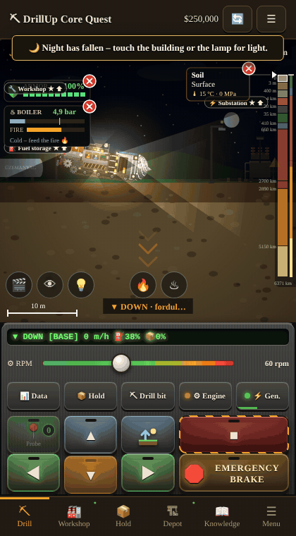

# DrillUp Core Quest

🇬🇧 English · [🇭🇺 Magyar](README.hu.md)

<p align="center"></p>

<p align="center"><b><a href="https://drillup-seven.vercel.app">▶ Play now</a></b> &nbsp;·&nbsp; <b><a href="https://github.com/strattila90-hue/DrillUp/releases/latest/download/CoreQuest.apk">📱 Download APK</a></b></p>

<p align="center">

[](LICENSE)
[](https://github.com/strattila90-hue/DrillUp/commits)
[](https://github.com/strattila90-hue/DrillUp/releases/latest)
[](https://github.com/strattila90-hue/DrillUp)


[](https://github.com/strattila90-hue/DrillUp/stargazers)

</p>

Drill down to the Earth's core – 6,371 km – in real meters. A tracked drilling machine, real geological layers, temperature and pressure, wear and armor, a depot with a freight train, minerals, fossils and collectible film relics. Single-player, offline-capable, no ads, no accounts, no tracking.

## Screenshots
<p> &nbsp; </p>

## Features
- **Real scale**: soil → crust → mantle → outer core → inner core, with realistic layer thicknesses (layer map on the right).
- **A machine you build**: engines (steam → diesel → gas turbine → nuclear), armor, 6 drill bit tiers, generator, boiler, emergency brake with mechanical arms, hydraulic erector with a tower crane.
- **Depot & economy**: unload the hold, compress, store, sell by freight train. Storage yard, conveyor, wagons and locomotive upgrade up to **level 20**. Freight port with gantry cranes and railway signals.
- **Exploration**: seismograph and probes, oil and gas fields, volcanoes, mobile geological lab, reports from real drilling history, hidden finds.
- **Hall of Fame**: 12 original, fictional film relics to dig up.
- **Languages**: Hungarian and English (Menu → Settings → Language; English is the default on first start).
- **PWA**: installable, works offline, your save stays on your device.

## Run / develop
No build step – static files.
```
python3 -m http.server 8000      # then open http://localhost:8000
npm test                         # node tests/run.js  (headless; no browser needed)
node tests/par.js 2              # full test run on 2 processes (~3 min)
```
Structure: `index.html` (core + inline script) · `js/*.js` (feature modules, loaded as plain script tags) · `ui.css` · `sw.js` (service worker, network-first; bump the cache name `V` and add new files to `A`) · `manifest.webmanifest` · `tests/`.

### Localization
`js/i18n.js` is a translation layer: when the language is English it replaces visible text (DOM text, labels, text drawn on canvas) using the dictionary in `js/i18n_en.js` (`"hungarian text": "English text"`). Texts that are not in the dictionary stay Hungarian. To add a string: add it to the dictionary and reload. The language is stored in `localStorage` (`du_lang`), not in the save.

## Save data
Stored in the browser's local storage. Menu → Settings → Data: **export / import** your save regularly.

## Compatibility
Chrome / Android WebView 80+ (optional chaining syntax), Safari 13.1+. A polyfill (`js/compat.js`) covers `Array.at`, `flat`, `flatMap` on older engines. Touch-first, portrait; vibration, wake lock and fullscreen are used only where available.

## Google Play
A standalone, fully offline Android APK / iOS build (Capacitor) is built by GitHub Actions – see [`mobile/README.md`](mobile/README.md). The Play build can be that AAB or a Trusted Web Activity wrapper around the hosted PWA – see [`play/CHECKLIST.md`](play/CHECKLIST.md), [`play/STORE_LISTING.md`](play/STORE_LISTING.md) and [`privacy.html`](privacy.html).

## Tech
Vanilla JavaScript, HTML5 canvas and CSS – no framework, no bundler, no runtime dependencies. Installable PWA with a service worker; the Android/iOS builds wrap the same files with Capacitor. Tests are plain Node scripts (`tests/`).

## Contributing
Bug reports, ideas and pull requests are welcome – see [CONTRIBUTING.md](CONTRIBUTING.md). Issues labelled `good first issue` are a good place to start.

## License / credits
Released under the [MIT License](LICENSE). All game content and the film relics are original and fictional. Developer: strattila90.

---
⭐ If you like it, please give it a star — it really helps!

## v5.27
- **Laptop / wide screens:** a tidy layout – fixed-size, centred control strip and a centred main menu.
- **Shiny worn-metal machine:** strong specular band, deep shading, fine scratches and a slow glint sweeping across the body and armour.

## v5.26
- **L-shaped HUD, less space:** a much bigger game view. The instruments float on the view without boxes (right: pressure, temperature, cargo and a new bit-wear gauge); fuel, engine and generator sit in the bottom control strip.
- **No duplicate controls:** instead of the Engine/Gen levers and the Data/Hold/Bit tabs, tap the instruments to switch or open the panel.
- **Joystick** instead of the four direction buttons and STOP: drag towards a direction; release to stop, push to the end stop and it latches and keeps going (gold ring); tap = stop.

## v5.25
- **New control layout:** ▲▼◀▶ as a real direction cross with STOP in the centre (one move from any direction); the function buttons wrap around it in an L: Surface and Probe on the right, a wide Emergency brake along the bottom.

## v5.24
- **Soviet-style mechanical instrument panel** on the console (original artwork): sight-glass fuel gauge, steel-rimmed pressure gauge, brass-rimmed thermometer, olive cargo and generator meters, engine tachometer – screwed bezels, red zones, springy needles that tremble with the engine running, blinking warning lamps. Tap the instruments: engine and generator on/off, refuel, Cargo / Data panel.
- **Toggle levers** with indicator lamps instead of the Engine and Generator buttons.
- **Launch pad:** a concrete pad with a wellhead and a yellow gantry crane at the base. You can only drill down from here; the crane hooks the machine's tail, pulls it to the pad centre and lifts it into drilling position. You can only surface here too (the ⌂ way home leads here).

## v5.23
- **Artwork at the drilling station:** original illustrations drawn from real photos and technical diagrams (`assets/rig/`): a slender red-and-white mast and a yellow X-braced substructure with a white rig-floor cabin; tricone (carbide insert) and PDC diamond bits with 6-frame spinning animation; a colour-coded bottom-hole assembly (bit sub, turbodrill, stabiliser, drill collars, jar, heavy-weight pipe).
- **📘 Drill string lesson:** the parts of the drill string from top to bottom, the two bit types compared, and what a core is (summarised from University of Szeged outreach material).

## v5.22
- **SG-3 drilling station – lifelike model:** substructure and rig floor, blowout preventer (BOP), crown and travelling block with drill line, drawworks drum turning with the drilling, top drive with mud hose, monkey board (stands rack up there while tripping), shale shaker and steaming mud pit, diesel generator with smoke, triplex mud pump with moving pistons, floodlights, polar snowfall.
- **Underground:** a pattern for every rock type, detailed bottom-hole assembly (drill collars, stabiliser, turning turbodrill, mud jets), rock glowing red in the hot depths.
- **New gameplay:** bit choice (tricone or PDC diamond: PDC is faster in soft rock but wears quickly in hard, hot rock), a core tray with the collected cores, a depth–time curve.

## v5.21
- **New main menu**: emblem, "Path to the core" bar with the Earth's shells and a record marker, money and machine on one card, big start button, 4 tiles (Settings, Update, Share, Install), and Privacy · GitHub · New game at the bottom.
- **Custom-drawn icons** instead of emoji (top bar, bottom navigation, console tabs, direction pad, Stop/Emergency brake, Probe, floating buttons): identical and crisp on every device.
- Floating canvas buttons line up automatically (the 🗼 button no longer covers the displays button); the Stop button is labelled "STOP".
- Lower resource use: the menu background renders at ~30 fps and lower resolution (menu CPU roughly halved), the menu loop no longer runs during play; gentler resolution cap (1 / 1.25 / 1.6×) – steadier frames while drilling.

## v5.20
- **New: SG-3 Russian superdeep drilling station** (modelled on the Kola Superdeep Borehole) at the surface base (🗼 button or tap the derrick). Drilling in stages: each stage is one stand (1–3 × 12 m pipes), then a new pipe must be made up – pipes have to be bought (aluminium LBT, steel, titanium). 5 derrick levels (BU-75 → Uralmash-15000, 15 km).
- Simplified real physics: buoyant string weight in mud, hook load, aluminium weakening with heat, fatigue, buckling, turbodrilling, cuttings and stuck pipe, bit wear and tripping. Overload causes a **pipe failure**: the string below stays in the hole and you sidetrack and drill again.
- Button controls (drill, make-up, bit change, weight on bit, mud flow, zoom), **automatic zoom onto the bit while drilling**, layer-coloured cross-section, real scientific milestones (microfossils, "no basalt", 180 °C, 12,262 m).
- Smoother rendering: lights come from pre-rendered sprites (no per-frame gradients), lower-resolution darkness layer; more vivid layer and sky colours.

## v5.19
- Main menu: a discreet "⭐ Star on GitHub" link.

## v5.18 additions
- Skippable first-run tutorial (replay from Settings); original background music (volume slider in Settings); local, opt-in error report (copy from Settings – nothing is sent anywhere).
- In English the in-game currency is shown as USD ($); only the label changes, values are unchanged.
- In-game windows are smaller/less intrusive and have a clear red ✕ close button (👁 brings them back).
- Main menu now shows the drilling machine with a compact button row; the "Home" button became a "Surface" button (arrow up to the ground); Mineral library, Classroom and volcano texts are available in English.
- Solar backup drive: on the surface the machine can always move horizontally. If the fuel runs out, solar panels on the roof power electric motors (slow, daytime only – at night wait for morning).

⭐ If you like it, please give it a star — it really helps!
